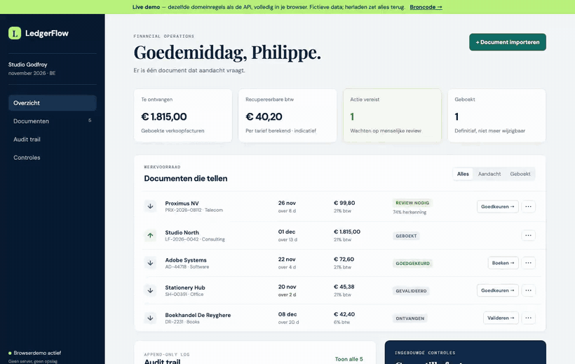
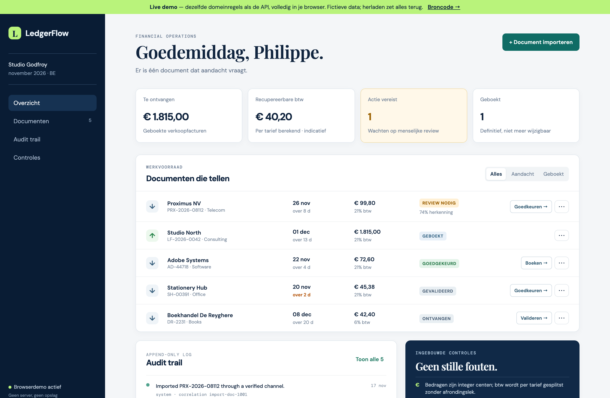
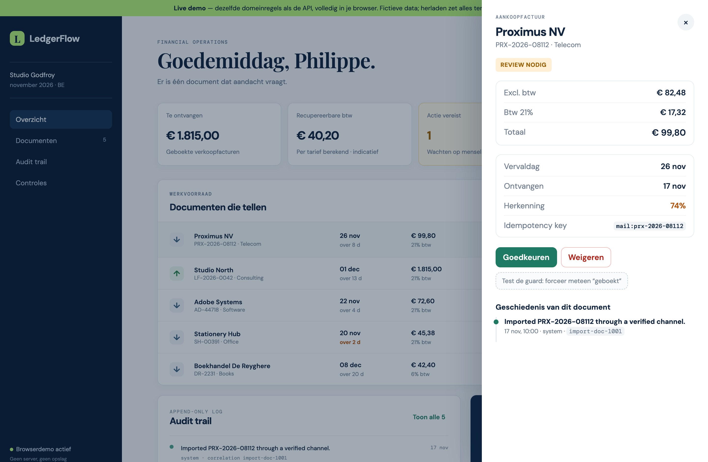
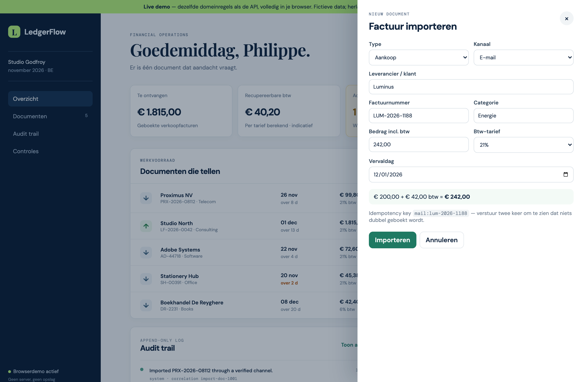
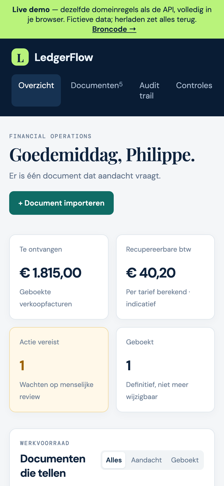
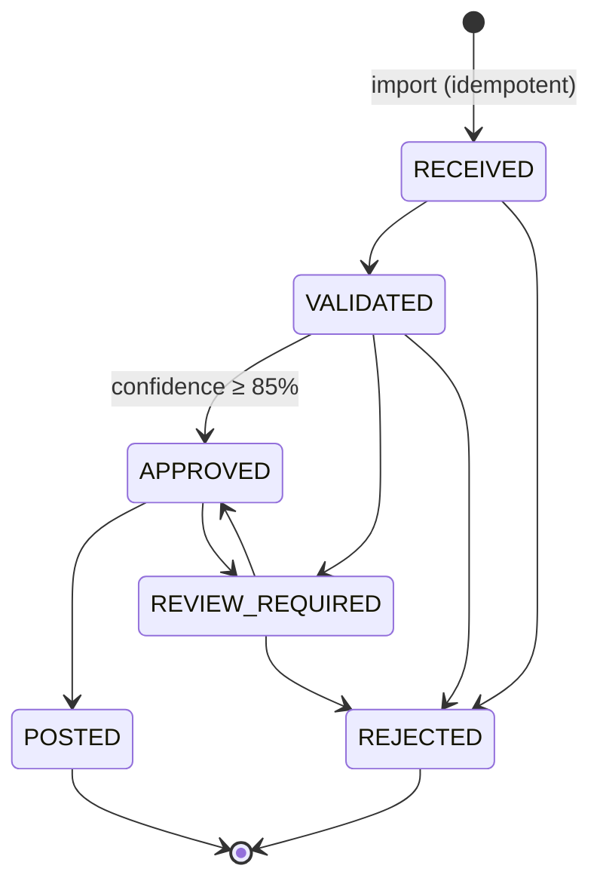
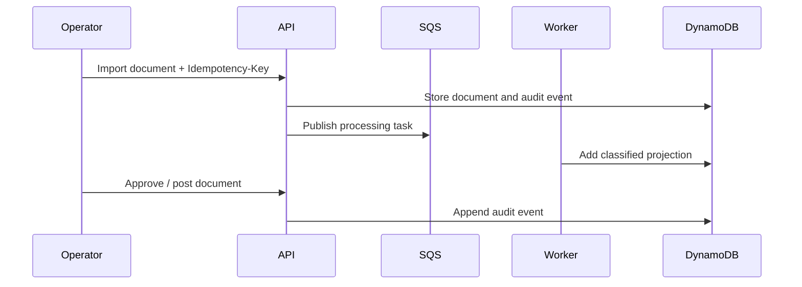

# LedgerFlow Belgium

> Financial control, with receipts.

[](https://github.com/phlppgdfry/ledgerflow-belgium/actions/workflows/ci.yml)     

LedgerFlow is a portfolio-grade financial operations cockpit for Belgian sole proprietors. It follows one high-risk flow end to end: a financial document enters the system, is validated and reviewed, moves through a guarded state machine, and leaves an auditable trail.

**[▶ Try the live demo](https://phlppgdfry.github.io/ledgerflow-belgium/)** — no install. It runs the same domain package as the API, entirely in your browser.

<p align="center">
  <a href="https://phlppgdfry.github.io/ledgerflow-belgium/"></a>
</p>

> **Important:** this is a technical demonstrator. It is not tax, legal, accounting or Peppol-compliant software. All business data and VAT calculations are fictional and illustrative.

## Try these three things in the demo

1. **Approve and book.** Open _Proximus NV_ (74% extraction confidence, so it needs a human), press **Goedkeuren**, then **Boeken**. Every step lands in the document's own history with actor and correlation ID.
2. **Break the rules.** Open _Boekhandel De Reyghere_ and press _Test de guard_. The state machine refuses `RECEIVED → POSTED` with the same `409` the API returns.
3. **Deliver twice.** Press **+ Document importeren** and submit the form twice. The second delivery is recognised by its idempotency key and nothing is booked twice.

| Dashboard                                                                                                                 | Document detail                                                                                                                        | Import                                                                                                     |
| ------------------------------------------------------------------------------------------------------------------------- | -------------------------------------------------------------------------------------------------------------------------------------- | ---------------------------------------------------------------------------------------------------------- |
|  |  |  |

<details><summary>Mobile</summary>

</details>

## Why this exists

Financial products must be fast _and_ explainable when something goes wrong. This project demonstrates the engineering practices that make that possible:

- Vue 3 dashboard for review work, not just data display;
- Node.js API with a safe import contract and correlation IDs on every response;
- monetary amounts represented as integer eurocents, VAT split per rate (21/12/6/0%) without rounding leaks;
- an explicit, tested document state machine, plus a confidence threshold below which nothing is approved without review;
- append-only audit events;
- idempotent imports, so retried delivery cannot silently duplicate a document (`202` first time, `200 + duplicate: true` after);
- one domain package (`@ledgerflow/core`) used by the API **and** the browser demo, so the demo cannot drift from the real rules;
- AWS serverless reference infrastructure with DynamoDB, SQS/DLQ, SNS, Lambda, API Gateway and optional OpenSearch;
- Pulumi and GitHub Actions from the start.

## State machine



## Demo flow

1. An invoice is received from email, upload or an e-invoice channel.
2. The API validates an idempotency key and stores it only once.
3. A processing event is published to the queue.
4. The operator reviews exceptions and advances the document deliberately.
5. Each status change becomes an immutable audit event with actor, time and correlation ID.
6. A worker can build read models and send reminders without blocking the main request.



## Local setup

Prerequisite: Node.js 22+ and npm 11+.

```bash
npm install
npm run dev:api        # Fastify API on http://127.0.0.1:3001
```

In a second terminal:

```bash
npm run dev            # Vue app on http://localhost:5173, proxies /api to the API
```

Or run the browser-only demo without the API: `npm run dev:demo`. No build step is needed first:
in development both apps import `@ledgerflow/core` straight from its TypeScript source.

### Verify it

```bash
npm run format:check
npm run typecheck
npm test               # 17 core tests + 5 API tests (Fastify inject)
npm run build
```

### Useful API calls

```bash
curl http://localhost:3001/api/dashboard

curl -X POST http://localhost:3001/api/documents/doc-1001/transition \
  -H 'content-type: application/json' \
  -d '{"status":"APPROVED","actor":"demo.user"}'

# Run twice: 202 the first time, 200 with "duplicate": true the second time
curl -i -X POST http://localhost:3001/api/documents/import \
  -H 'content-type: application/json' -H 'Idempotency-Key: mail:lum-77' \
  -d '{"kind":"PURCHASE","supplier":"Luminus","invoiceNumber":"LUM-77","grossCents":24200,"vatRateBasisPoints":2100,"dueDate":"2026-12-15","category":"Energy","confidence":0.93}'
```

The API returns `409 Conflict` for invalid financial state transitions, `400` with the validation issues for bad input, and an `x-correlation-id` header on every response.

## Repository layout

```text
apps/web       Vue 3 operator workspace (talks to the API, or runs the core in-browser for the demo)
apps/api       Fastify / Node.js API; buildApp() is separate from listen() so it is tested in-process
packages/core  Money, VAT, state machine, euro parsing and the in-memory ledger — shared by both
infra          Pulumi AWS reference infrastructure
docs           Architecture decisions and operational constraints
```

## Deploying the AWS reference infrastructure

The Pulumi program creates encrypted DynamoDB storage with point-in-time recovery, an SQS processing queue and DLQ, SNS, Lambda and API Gateway. OpenSearch is disabled by default because it carries a material cost.

```bash
cd infra
pulumi login
pulumi stack init dev
pulumi config set aws:region eu-west-1
pulumi preview
pulumi up
```

To provision OpenSearch deliberately:

```bash
pulumi config set enableSearch true
pulumi preview
```

See [architecture decisions](docs/architecture.md) for the data-integrity and operations design.

## Production hardening that comes next

- Replace the in-memory adapter with DynamoDB repositories using conditional writes.
- Process SQS events with a dedicated Lambda and a replay-safe outbox pattern.
- Store original documents in encrypted S3 with retention policy and malware scanning.
- Add Cognito or an existing identity provider, tenant-scoped authorization and immutable retention controls.
- Add CloudWatch dashboards and alarms for API failures, queue age, DLQ depth and state-transition failures.
- Add contract tests against e-invoice and bank-provider adapters.

## License

MIT. Built by [Philippe Godfroy](https://github.com/phlppgdfry).
