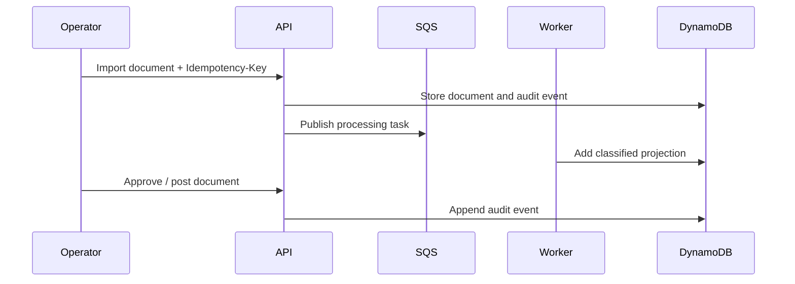

# LedgerFlow Belgium

> Financial control, with receipts.

LedgerFlow is a portfolio-grade financial operations cockpit for Belgian sole proprietors. It follows one high-risk flow end to end: a financial document enters the system, is validated and reviewed, moves through a guarded state machine, and leaves an auditable trail.

   

> **Important:** this is a technical demonstrator. It is not tax, legal, accounting or Peppol-compliant software. All business data and VAT calculations are fictional and illustrative.

## Why this exists

Financial products must be fast _and_ explainable when something goes wrong. This project demonstrates the engineering practices that make that possible:

- Vue 3 dashboard for review work, not just data display;
- Node.js API with a safe import contract and correlation IDs;
- monetary amounts represented as integer eurocents;
- an explicit, tested document state machine;
- append-only audit events;
- idempotent imports, so retried delivery cannot silently duplicate a document;
- AWS serverless reference infrastructure with DynamoDB, SQS/DLQ, SNS, Lambda, API Gateway and optional OpenSearch;
- Pulumi and GitHub Actions from the start.

## Demo flow

1. An invoice is received from email, upload or an e-invoice channel.
2. The API validates an idempotency key and stores it only once.
3. A processing event is published to the queue.
4. The operator reviews exceptions and advances the document deliberately.
5. Each status change becomes an immutable audit event with actor, time and correlation ID.
6. A worker can build read models and send reminders without blocking the main request.



## Local setup

Prerequisite: Node.js 22+ and npm 11+.

```bash
npm install
npm run dev:api
```

In a second terminal:

```bash
npm run dev
```

Open the printed Vite URL (normally `http://localhost:5173`). The Vite development server proxies `/api` to the local API on port 3001.

### Verify it

```bash
npm run format:check
npm run typecheck
npm test
npm run build
```

### Useful API calls

```bash
curl http://localhost:3001/api/dashboard

curl -X POST http://localhost:3001/api/documents/doc-1001/transition \
  -H 'content-type: application/json' \
  -d '{"status":"APPROVED","actor":"demo.user"}'
```

The API intentionally returns `409 Conflict` for invalid financial state transitions and includes the correlation ID in error responses.

## Repository layout

```text
apps/web       Vue 3 operator workspace
apps/api       Fastify / Node.js API and in-memory demo adapter
packages/core  Financial primitives and domain state machine
infra          Pulumi AWS reference infrastructure
docs           Architecture decisions and operational constraints
```

## Deploying the AWS reference infrastructure

The Pulumi program creates encrypted DynamoDB storage with point-in-time recovery, an SQS processing queue and DLQ, SNS, Lambda and API Gateway. OpenSearch is disabled by default because it carries a material cost.

```bash
cd infra
pulumi login
pulumi stack init dev
pulumi config set aws:region eu-west-1
pulumi preview
pulumi up
```

To provision OpenSearch deliberately:

```bash
pulumi config set enableSearch true
pulumi preview
```

See [architecture decisions](docs/architecture.md) for the data-integrity and operations design.

## Production hardening that comes next

- Replace the in-memory adapter with DynamoDB repositories using conditional writes.
- Process SQS events with a dedicated Lambda and a replay-safe outbox pattern.
- Store original documents in encrypted S3 with retention policy and malware scanning.
- Add Cognito or an existing identity provider, tenant-scoped authorization and immutable retention controls.
- Add CloudWatch dashboards and alarms for API failures, queue age, DLQ depth and state-transition failures.
- Add contract tests against e-invoice and bank-provider adapters.

## License

MIT. Built by [Philippe Godfroy](https://github.com/KippieG).
