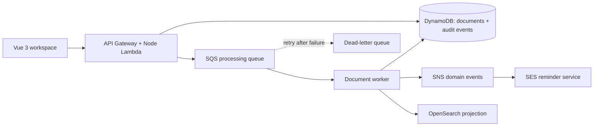

# Architecture decisions

## Non-negotiable domain rules

- Amounts are integer eurocents, never JavaScript floating-point numbers.
- An idempotency key identifies every import. Retrying a request returns the first document rather than creating a duplicate.
- A document can only move through the explicitly allowed state machine.
- Audit events are append-only. They contain a correlation ID, actor and timestamp.
- The DynamoDB table has point-in-time recovery and server-side encryption enabled.
- The production worker must alarm on oldest SQS message age and DLQ depth. A DLQ is an operational queue, not a graveyard: replay needs a documented runbook.

## Intentional limitations

LedgerFlow is a portfolio demonstrator, not accounting or tax software. VAT computations and document formats are illustrative only; no real legal filing or Peppol delivery is implemented.
